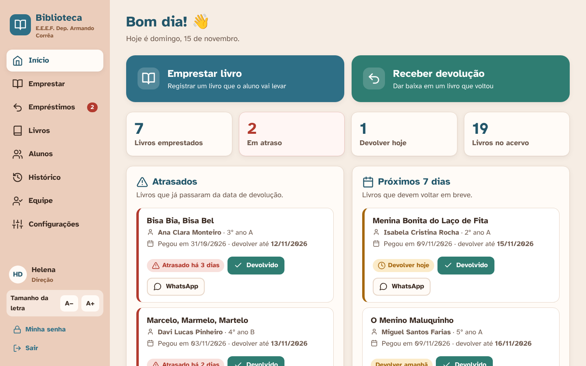
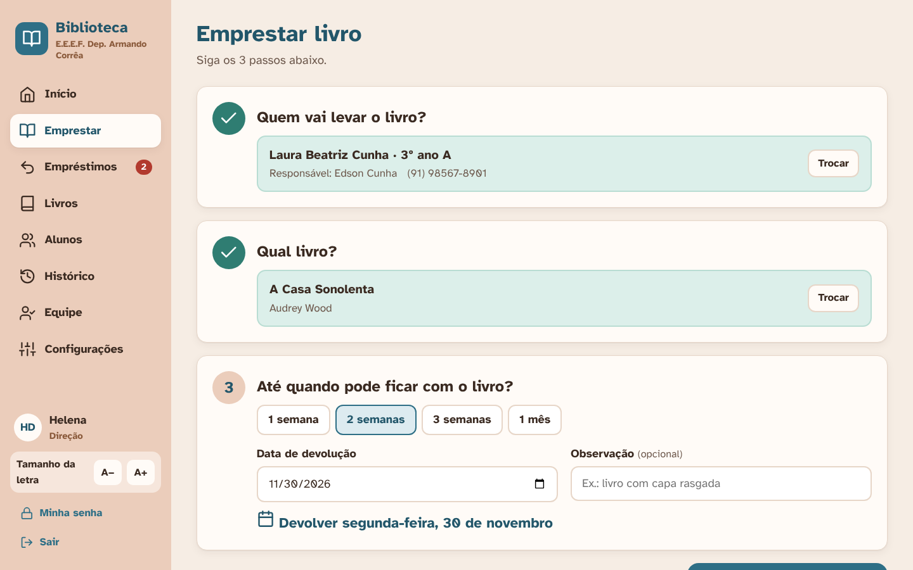
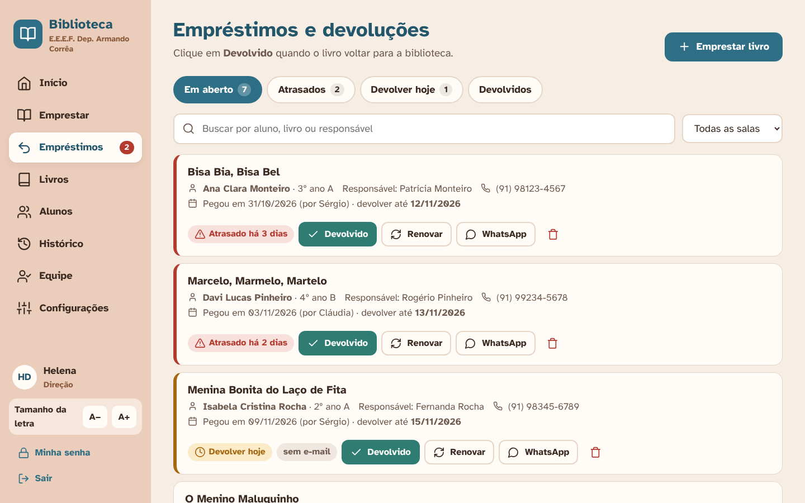
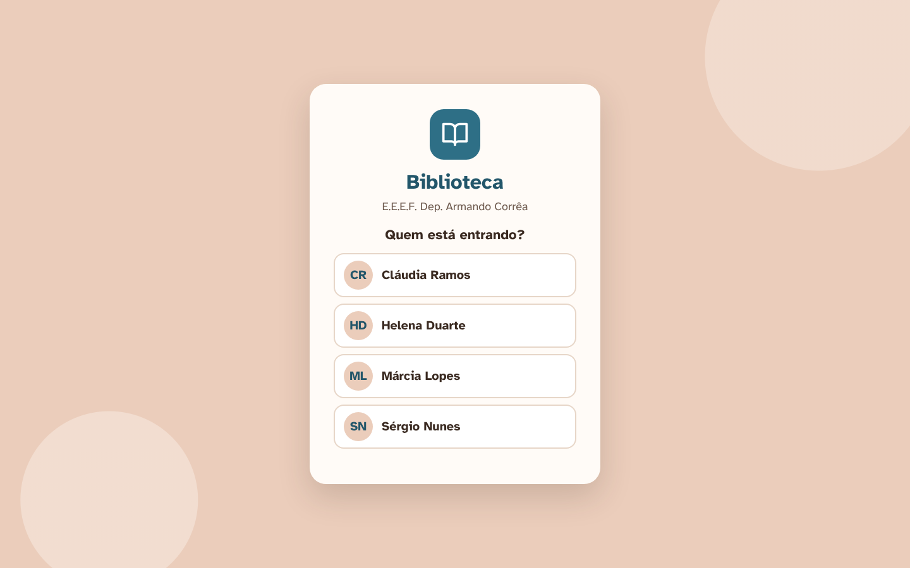
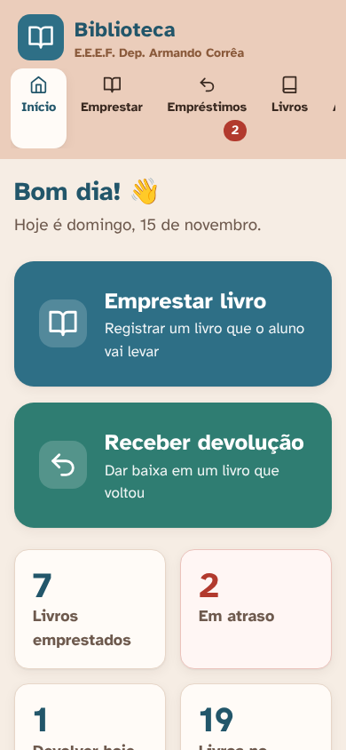

# 📚 Biblioteca Escolar

Sistema de empréstimo de livros que desenvolvi para a biblioteca da **E.E.E.F. Dep. Armando Corrêa**, uma escola pública de ensino fundamental no Pará. Hoje ele está em uso na escola.



## O problema

A biblioteca controlava os empréstimos no caderno. Era difícil saber quem estava com qual livro, quais estavam atrasados e avisar as famílias. Como os alunos são crianças, o contato é sempre com o responsável.

Quem usa o sistema no dia a dia são professoras e professores, muitos com mais idade e pouca familiaridade com computador. Por isso tratei a facilidade de uso como requisito principal, mais importante que qualquer recurso extra.

## O que eu fiz

- **Empréstimo em 3 passos**: aluno → livro → data de devolução, com atalhos de "1 semana", "2 semanas" etc. O prazo nunca cai em fim de semana.
- **Devolução e renovação com um clique**, e um botão de **WhatsApp** que já abre a mensagem pronta para o responsável.
- **Lembretes automáticos por e-mail**: antes do prazo, no dia e depois do vencimento. A direção escolhe horário, dias e frequência, e a tela resume a regra em português simples.
- **Cadastro de livros** (ISBN opcional, com preenchimento automático pela BrasilAPI/Open Library) e de **alunos com os dados do responsável**.
- **Equipe com perfis**: a direção cadastra as bibliotecárias e cada pessoa tem a própria senha. O histórico registra quem fez cada empréstimo e cada devolução.
- **Histórico** de empréstimos, de atividades e dos e-mails enviados, com exportação para planilha.
- **Cópia de segurança automática** todo dia.

| Empréstimo | Lembretes por e-mail |
|---|---|
|  |  |

| Empréstimos e devoluções | Equipe |
|---|---|
|  |  |

<p align="center"> </p>

> As telas usam dados fictícios.

## Decisões de projeto

**Acessibilidade em primeiro lugar.** A letra base é de 18 px, com botão A−/A+ para aumentar. A fonte é a [Atkinson Hyperlegible](https://www.brailleinstitute.org/freefont/), criada para leitores com baixa visão. Todo botão tem texto, não só ícone, toda ação importante pede confirmação e as mensagens de erro dizem o que fazer. Na entrada, a pessoa clica no próprio nome em vez de digitar um usuário.

**Leve e sem dependências pesadas.** A escola tem um computador simples e a internet nem sempre ajuda. O servidor tem só duas dependências (Express e Nodemailer). O banco é o SQLite que já vem no Node (`node:sqlite`), então não há módulo nativo para compilar no Windows. A interface é HTML, CSS e JavaScript puros, sem framework nem etapa de build: são cerca de 130 KB e funcionam offline.

**Roda na rede da escola.** O sistema fica num computador da escola e os outros aparelhos acessam pelo navegador na mesma rede. Para instalar basta o Node e dois cliques num `.bat`.

**Lembretes sem duplicidade.** O agendador confere a cada 5 minutos se já passou do horário configurado e decide, para cada empréstimo, qual aviso é devido. O registro de envios garante que ninguém recebe o mesmo e-mail duas vezes. Se o computador estiver desligado no horário, os envios acontecem quando ele voltar.

**Dados de crianças.** O acesso é por conta individual, as senhas usam hash scrypt e a sessão fica em cookie HttpOnly. A senha do e-mail fica só no banco local, nunca no código, e a pasta `dados/` não vai para o repositório.

## Tecnologias

Node.js 22+ · Express · SQLite (`node:sqlite`) · Nodemailer · HTML/CSS/JS puro · `node:test`

## Como rodar

```bash
npm install
npm start          # abre em http://localhost:3000
npm run demo       # mesma coisa, mas com dados fictícios para explorar (senha: 1234)
npm test           # testes unitários e de ponta a ponta
```

No primeiro acesso, o sistema pede para criar a conta da direção. O modo demo usa uma pasta separada (`dados-demo/`), recriada a cada execução, e não mexe nos dados reais. No Windows, o `instalar.bat` instala tudo e cria um ícone "Biblioteca" que abre o sistema numa janela própria, como um programa. Ele também liga o servidor em segundo plano junto com o Windows. No Chromebook (ambiente Linux) ou em qualquer Debian/Ubuntu, `bash instalar-chromebook.sh` instala o Node, as dependências e um serviço que liga o sistema sozinho. O passo a passo para a escola (instalação, Gmail, cópias de segurança) está no [manual](docs/MANUAL.md).

## Estrutura

```
src/
  server.js         rotas da API, login e permissões
  db.js             esquema do banco, migrações e configurações padrão
  lembretes.js      agendador de e-mails e cópia de segurança diária
  demo.js           modo demonstração com dados fictícios
  datas.js          utilidades de data (sempre AAAA-MM-DD, no fuso local)
public/             interface (index.html, app.js, estilo.css, fontes)
tests/              testes com node:test (sobem o servidor com um banco temporário)
docs/               manual da escola e telas
```

## Licença

O código está disponível para consulta como parte do meu portfólio. Todos os direitos reservados.
