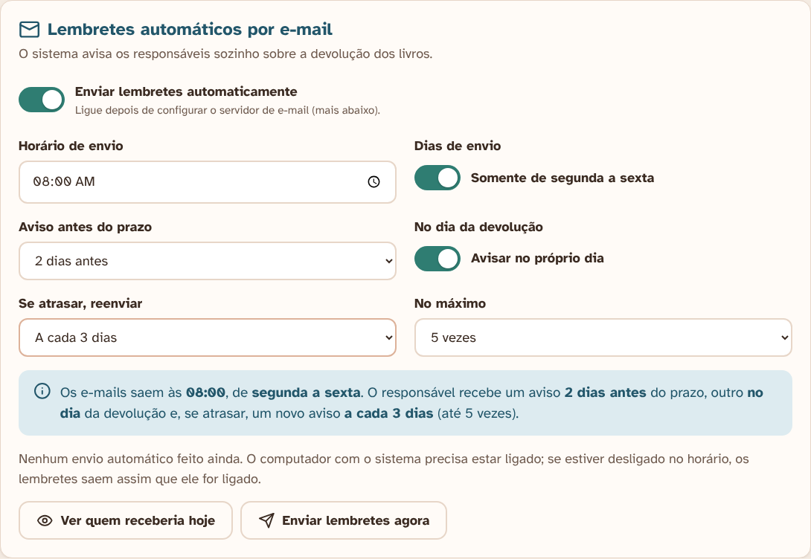
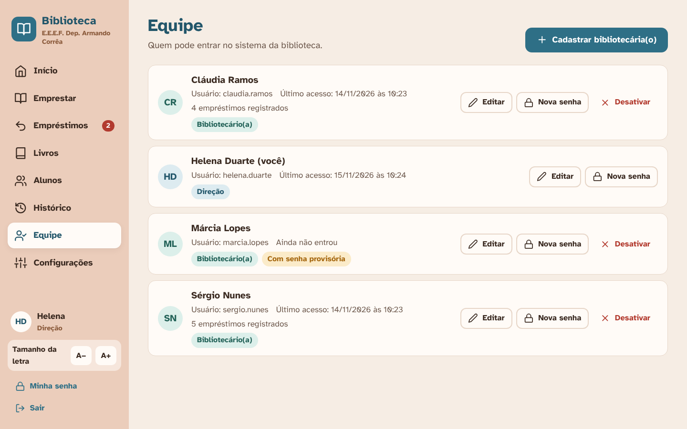

# 📚 Biblioteca Escolar

Sistema de empréstimo de livros que desenvolvi para a biblioteca da **E.E.E.F. Dep. Armando Corrêa**, uma escola pública de ensino fundamental no Pará. Hoje ele está em uso na escola.


## O problema

A biblioteca controlava os empréstimos no caderno. Era difícil saber quem estava com qual livro, quais estavam atrasados e avisar as famílias. Como os alunos são crianças, o contato é sempre com o responsável.

Quem usa o sistema no dia a dia são professoras e professores, muitos com mais idade e pouca familiaridade com computador. Por isso tratei a facilidade de uso como requisito principal, mais importante que qualquer recurso extra.

## O que eu fiz

- **Empréstimo em 3 passos**: aluno → livro → data de devolução, com atalhos de "1 semana", "2 semanas" etc. O prazo nunca cai em fim de semana.
- **Devolução e renovação com um clique**, e um botão de **WhatsApp** que já abre a mensagem pronta para o responsável.
- **Lembretes automáticos por e-mail**: antes do prazo, no dia e depois do vencimento. A direção escolhe horário, dias e frequência, e a tela resume a regra em português simples.
- **Cadastro de livros** (ISBN opcional, com preenchimento automático pela BrasilAPI/Open Library) e de **alunos com os dados do responsável**.
- **Equipe com perfis**: a direção cadastra as bibliotecárias e cada pessoa tem a própria senha. O histórico registra quem fez cada empréstimo e cada devolução.
- **Histórico** de empréstimos, de atividades e dos e-mails enviados, com exportação para planilha.
- **Cópia de segurança automática** todo dia.

| Empréstimo | Lembretes por e-mail |
|---|---|
|  |  |

| Empréstimos e devoluções | Equipe |
|---|---|
|  |  |

<p align="center"> </p>

> As telas usam dados fictícios.

## Decisões de projeto

**Acessibilidade em primeiro lugar.** A letra base é de 18 px, com botão A−/A+ para aumentar. A fonte é a [Atkinson Hyperlegible](https://www.brailleinstitute.org/freefont/), criada para leitores com baixa visão. Todo botão tem texto, não só ícone, toda ação importante pede confirmação e as mensagens de erro dizem o que fazer. Na entrada, a pessoa clica no próprio nome em vez de digitar um usuário.

**Leve, sem etapa de build.** A interface é HTML, CSS e JavaScript puros, sem framework: são cerca de 130 KB, e a fonte é servida pelo próprio sistema. O servidor é um app Express com quatro dependências (Express, Nodemailer, `pg` e PGlite).

**Um código, dois jeitos de rodar.** Na nuvem, o sistema roda na Vercel com o banco no Supabase, os dois na região de São Paulo, e cada escola tem projeto e banco separados. Sem `DATABASE_URL`, o mesmo código usa o [PGlite](https://pglite.dev), um Postgres que roda dentro do próprio Node. Assim o sistema também funciona num computador da escola, sem internet e sem instalar banco de dados: dois cliques num `.bat` no Windows ou um script no Linux do Chromebook. Os testes rodam nos dois.

**Lembretes sem duplicidade.** Na nuvem, o Vercel Cron chama o sistema a cada 10 minutos; localmente, um relógio interno faz o mesmo. Em cada verificação, o sistema decide qual aviso é devido para cada empréstimo. Uma trava no banco impede dois envios simultâneos, e o registro de envios garante que ninguém recebe o mesmo e-mail duas vezes. Datas e horários usam sempre o fuso do Pará, mesmo com o servidor em UTC.

**Dados de crianças.** O acesso é por conta individual, as senhas usam hash scrypt e a sessão fica em cookie HttpOnly e Secure. O limite de tentativas de senha fica no banco, para valer em todas as instâncias. Os dados ficam no Brasil, e a senha do e-mail fica só no banco, nunca no código.

## Tecnologias

Node.js 20+ · Express · PostgreSQL (Supabase / PGlite) · Vercel (Functions + Cron) · Nodemailer · HTML/CSS/JS puro · `node:test`

## Como rodar

```bash
npm install
npm start          # abre em http://localhost:3000
npm run demo       # mesma coisa, mas com dados fictícios para explorar (senha: 1234)
npm test           # testes unitários e de ponta a ponta
```

Sem `DATABASE_URL`, o sistema usa o PGlite na pasta `dados/`. Com ela, usa o Postgres informado. No primeiro acesso, o sistema pede para criar a conta da direção. A publicação na Vercel + Supabase está passo a passo no [manual](docs/MANUAL.md#publicar-na-internet-vercel--supabase). O modo demo usa uma pasta separada (`dados-demo/`), recriada a cada execução, e não mexe nos dados reais. No Windows, o `iniciar.bat` instala e abre tudo com dois cliques. No Chromebook (ambiente Linux) ou em qualquer Debian/Ubuntu, `bash instalar-chromebook.sh` instala o Node, as dependências e um serviço que liga o sistema sozinho. O passo a passo para a escola (instalação, Gmail, cópias de segurança) está no [manual](docs/MANUAL.md).

## Estrutura

```
src/
  app.js            rotas da API, login e permissões
  server.js         servidor local (computador da escola)
  db.js             Postgres: Supabase via pg ou PGlite embutido; esquema e configurações
  lembretes.js      lembretes por e-mail (Vercel Cron ou relógio local) e cópias em JSON
  restaurar.js      restaura uma cópia de segurança num banco vazio
  demo.js           modo demonstração com dados fictícios
  datas.js          utilidades de data (sempre AAAA-MM-DD, no fuso local)
public/             interface (index.html, app.js, estilo.css, fontes)
api/index.js        entrada na Vercel (vercel.json: região gru1, rotas e cron)
tests/              testes com node:test (sobem o servidor com um banco temporário)
docs/               manual da escola e telas
```

## Licença

O código está disponível para consulta como parte do meu portfólio. Todos os direitos reservados.
